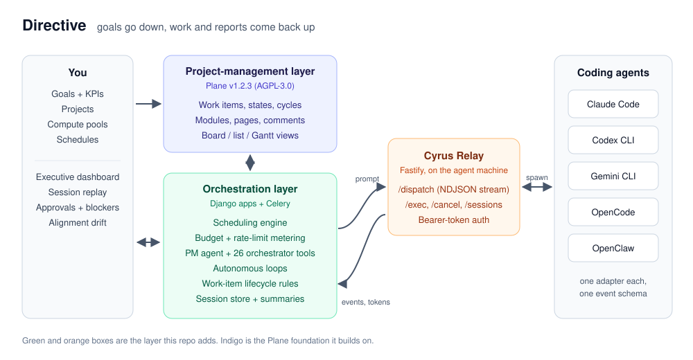
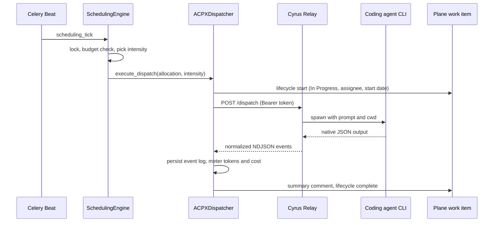

# Directive

**Autonomous agent orchestration on top of a real project-management system.** You set goals, budgets and schedules. A PM agent breaks the work into stories, dispatches Claude Code, Codex, Gemini CLI, OpenCode or OpenClaw workers to do them, checks their output, and reports back through the same boards, cycles and dashboards a human team would use.



The mental model is a CEO with a staff: directives go down, reports come up. Directive treats your AI subscriptions and API keys as a budget to spend on purpose. It decides what to run, when, on which agent and how hard, and keeps a full replayable record of every session.

The project-management foundation is a fork of [Plane](https://github.com/makeplane/plane) v1.2.3 (AGPL-3.0). Everything that makes agents first-class citizens of that system is new code in this repo: about 17,000 lines across Django apps, a Celery scheduling layer, a TypeScript agent relay and a set of React views. The codename in the source tree is **Cyrus**, so that is the name you will see in package names, models and the UI.

## What the agents do

**The PM agent ("Cyrus")** is a registered agent with `is_cyrus_agent=True`. It never writes product code itself. It works through a registry of 26 orchestrator tools exposed as a Django management command (`python manage.py cyrus_tool <tool> '<json>'`), so any CLI agent can drive the backend with plain shell calls and no MCP:

| Area | Tools |
|---|---|
| Planning | `manage_goals_and_projects`, `manage_cycles_and_modules`, `configure_project_workflow`, `define_kpi_schema`, `log_kpi_datapoint` |
| Backlog | `create_work_item`, `update_work_item`, `check_story_duplicates`, `search_workspace`, `get_markdown_view` |
| Execution | `start_story_session`, `force_start_story`, `interact_with_session`, `ask_agent_question`, `cancel_session`, `check_capacity_and_budget` |
| Reporting | `get_activity_data_for_summary`, `register_artifact`, `record_session_outcome`, `flag_alignment_drift` |
| Escalation | `escalate_to_human_blocker`, `request_human_approval`, `create_agent_spike` |
| Admin | `get_registered_agents`, `get_system_settings`, `update_system_settings` |

**Worker agents** are the coding CLIs. `start_story_session` hands a story to a worker, then runs a self-evaluation pass: the worker must answer `DONE: <summary>` or `INCOMPLETE: <gaps>`. Gaps go straight back to the worker as a targeted continuation prompt. After the configured number of passes the story either closes with a summary comment or stays open with a spike filed for the PM agent to reroute.

**Autonomous loops** run on Celery Beat and wake the PM agent with a specific brief:

| Loop | Cadence | Job |
|---|---|---|
| Visionary ideation | every 30 min | Read goals and recent outcomes, open research spikes or new stories |
| Backlog grooming | every 2 h | Enrich descriptions, trace dependencies, prune stale blockers |
| Janitor triage | every 4 h | Fail stuck sessions, check artifact links, estimate raw intake |
| Alignment audit | daily | Compare the week's work with goal descriptions, flag drift |
| Archivist | every 6 h | Mirror a markdown notes folder into workspace wiki pages |

## How it plugs into the project-management layer

Agents are not bolted on beside Plane. They live inside its data model:

- **Agents are assignees.** Work items move Backlog → In Progress → Done as sessions start and finish. Every transition goes through `WorkItemLifecycle`, which fills in whatever it can derive (assignee, start date, state, completion time, the session summary comment) and blocks the transition when required data is still missing.
- **Sessions attach to work items.** Each dispatch creates a `CyrusSession` holding the full NDJSON event stream, token usage, cost and outcome. When it finishes, a summary is posted as a comment on the work item.
- **Goals sit above projects.** Goals carry KPIs with time-series datapoints, link to Plane projects, and roll up into an executive dashboard alongside agent health, pool budgets, active blockers and alignment-drift flags.
- **Cycles run at agent speed.** Each project picks a 5-hour, 24-hour or 7-day cycle length, sized to agent session windows, and a `manage_cycles` task creates the next cycle from that setting.
- **Humans stay in the loop** through Plane's own notifications plus first-class `Approval` records and blocker work items.

## Compute management

This is the part that lets agents run unattended without burning a month of credits in an afternoon.

- **Compute pools** model either a flat-rate subscription (rolling usage windows) or a metered API key (USD budget per day, week or month). Agents draw from a pool.
- **Metering.** `ComputeTracker` writes a `PoolUsageRecord` for every session with input, output, cache and reasoning tokens. `BudgetService` caches pool state and answers "can I dispatch this?" with a reason.
- **Rate-limit learning.** Every 429 is stored as a `RateLimitEvent`. `PoolRateModel` blends configured limits with the observed floor so throughput estimates converge on what the provider actually allows.
- **Scheduling engine.** Schedules map time windows to projects or goals with a priority. Each tick, `SchedulingEngine` takes a per-workspace lock, skips allocations in cooldown, behind an open circuit breaker or already running, and picks a dispatch intensity from budget runway: `skip` above 95% utilization, `conservative` above 85% or under three days of runway, `aggressive` for high-priority work with plenty of headroom. Every decision is logged as a `SchedulingDecision` for later review.

## The relay

Coding agents run where your repositories and logins are, usually a workstation. The **Cyrus Relay** (`cyrus/relay`) is a small Fastify server that runs there and exposes:

| Endpoint | Purpose |
|---|---|
| `POST /dispatch` | Run a prompt and stream normalized events back as NDJSON |
| `POST /exec` | One-shot run that returns the final result |
| `GET /sessions`, `POST /cancel` | Inspect and stop running sessions |
| `GET/POST /workspace-files` | Read and write files in a project workspace |
| `GET /health`, `GET /agents` | Liveness and the list of enabled runners |

Each CLI has an adapter in `relay/src/agents/` (`claude-code.ts`, `codex.ts`, `gemini.ts`, `opencode.ts`, `openclaw.ts`) that builds the command line and translates that tool's native JSON output into one shared NDJSON event schema (`types/agent-events.ts`): streamed message chunks, a `done` event with token usage, cost and a per-model breakdown, and `relay_exit` / `relay_error` for process status. The backend never needs to know which CLI did the work. `agents/TEMPLATE.ts` is the starting point for a new one.



## Quickstart

Requirements: Docker with Compose, Node.js 22.18+, and pnpm 10 (via `corepack`). Run everything below from the `cyrus/` directory.

```bash
git clone https://github.com/joey12725/directive.git
cd directive/cyrus

# 1. Copy .env templates, generate a Django SECRET_KEY, install JS deps
./setup.sh

# 2. Start Postgres, Valkey, RabbitMQ, MinIO, the API, workers and Celery Beat
docker compose -f docker-compose-local.yml up -d

# 3. Start the web app (http://localhost:3000) and admin (http://localhost:3001)
pnpm dev
```

Open `http://localhost:3001` to create the instance admin, then sign in at `http://localhost:3000` and create a workspace.

Start the relay on the machine where your agent CLIs are installed and logged in:

```bash
cd directive/cyrus/relay
CYRUS_RELAY_SECRET=change-me CYRUS_RELAY_AGENT_LIST=claude,codex,gemini pnpm dev
```

Create a personal access token under **Profile settings → API tokens**, then give the workspace a compute pool through the REST API:

```bash
curl -X POST http://localhost:8000/api/v1/workspaces/<workspace-slug>/compute-pools/ \
  -H "X-Api-Key: $PLANE_API_TOKEN" -H "Content-Type: application/json" \
  -d '{"name": "Gemini", "pool_type": "api_billing", "provider": "google",
       "budget_limit_usd": "50.00", "budget_period": "monthly"}'
```

To watch the whole loop run end to end, `scripts/demo_sprint.py` registers a PM agent and a Gemini CLI worker against your relay, gives the PM agent a small product idea (a terminal snake game), and lets it lay out three stories in a new project and delegate each one to the worker:

```bash
docker exec -e DEMO_WORKSPACE_PATH=/path/on/relay/host \
  -e CYRUS_RELAY_URL=http://host.docker.internal:7420 \
  -e CYRUS_RELAY_SECRET=change-me \
  cyrus-api-1 python scripts/demo_sprint.py
```

The sessions, stories, comments and token usage show up in the project board, the session replay view and the executive dashboard as they happen. Once a PM agent exists, the Celery Beat loops above start waking it on their own.

On Linux, add `extra_hosts: ["host.docker.internal:host-gateway"]` to the `api` and `worker` services so containers can reach a relay on the host. Configuration details are in [docs/configuration.md](docs/configuration.md).

## Repository layout

```
cyrus/
  apps/api/plane/app/
    agents/            relay dispatcher (ACPXDispatcher) and agent health checks
    orchestrator/      tool registry, PM-agent loops, work-item lifecycle
    schedules/         scheduling engine, dispatch and cycle tasks
    metering/          usage tracker, budget service, rate-limit model
    sessions/          session summaries
    dashboard_metrics/ executive-dashboard aggregations
    wiki_sync/         markdown folder to wiki pages
  apps/api/plane/db/models/cyrus.py   Goal, GoalKPI, Agent, ComputePool, Schedule,
                                      ComputeAllocation, CyrusSession, Approval, ...
  apps/api/scripts/    bootstrap and end-to-end demo scripts
  apps/web/core/components/
    dashboard/ goals/ schedules/ sessions/ cyrus-lists/ cyrus-settings/
  relay/               Fastify relay and per-CLI runners
docs/                  architecture, configuration, extending
```

Everything else under `cyrus/` is Plane, rebranded, with targeted changes to settings, navigation and the API surface.

## Tech stack

- **Backend:** Python 3.12, Django 4.2, Django REST Framework, Celery 5 with Beat, PostgreSQL 15, Valkey/Redis, RabbitMQ
- **Frontend:** React 18, React Router 7, MobX, Tailwind, a pnpm + Turborepo monorepo
- **Relay:** Node.js 22, TypeScript, Fastify 5
- **Agents:** Claude Code, OpenAI Codex CLI, Gemini CLI, OpenCode, OpenClaw

## Docs

- [Architecture](docs/architecture.md): data model, dispatch path, scheduling and lifecycle in detail
- [Configuration](docs/configuration.md): environment variables, relay setup, beat tasks
- [Extending](docs/extending.md): adding an agent runner, an orchestrator tool or a loop

## License and credits

Directive is a derivative of [Plane](https://github.com/makeplane/plane) by Plane Software, Inc. and is released under the **GNU AGPL-3.0**, the same license as Plane. Plane's copyright headers and license are kept throughout `cyrus/`. See [LICENSE](LICENSE) and [NOTICE](NOTICE). Plane is a trademark of Plane Software, Inc., and this project is not affiliated with it.

Built by [Joey Hersh](https://github.com/joey12725).
